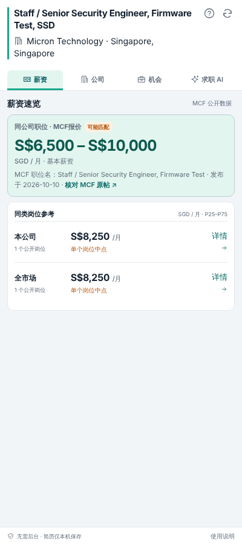
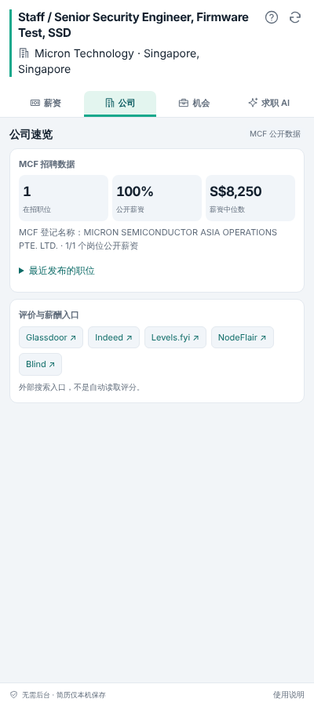
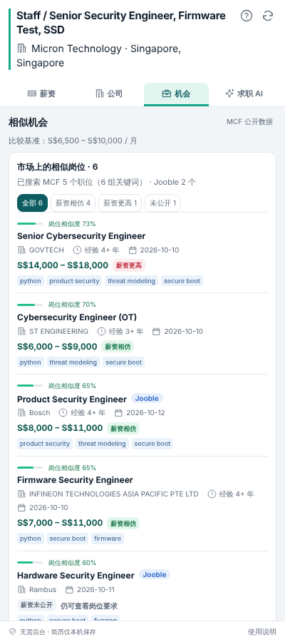
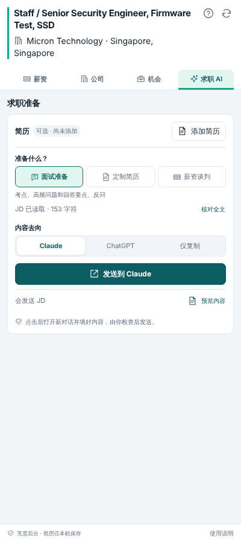

<p align="center">
  
</p>

<h1 align="center">SG Job Lens</h1>

<p align="center">
  在 LinkedIn 职位页旁边，看新加坡的公开薪资、相似职位，并一键准备面试和简历。<br>
  A Chrome side-panel extension for Singapore job seekers on LinkedIn.
</p>

---

## 它能做什么

打开任意 LinkedIn 职位，点工具栏里的 SG Job Lens 图标，Chrome 会在网页旁边打开侧边栏。网页会自动变窄、重新排版，不会被挡住。侧边栏分四个标签页：

| 薪资 | 公司 | 机会 | 求职 AI |
|---|---|---|---|
|  |  |  |  |

> 截图使用的是模拟数据。

### 薪资
- **本职位薪资区间**：按可信度依次查找，用找到的第一个，并标明来源：
  1. LinkedIn 职位页上显示的薪资；
  2. JD 里写明的薪资；
  3. [MyCareersFuture](https://www.mycareersfuture.gov.sg)（MCF，新加坡政府的招聘网站）上同一职位的公开薪资；
  4. 都没有时，用本公司（双倍权重）和全市场同类职位的公开薪资估算区间和中位数。资料不足时直接说明，不会编造。
- **本公司 / 全市场同类职位**：相近职位的薪资区间（P25–P75）和中位数，会按 JD 里要求的经验年限范围筛选。只比较标题里的职位部分（例如「Security Engineer, Firmware Test」只比「Security Engineer」）。样本少时会提示「小样本，谨慎参考」。
- 职位级别按职位标题判断，比如 Senior、Staff。

### 公司
- 这家公司在 MCF 上的在招职位数、公开薪资比例、薪资中位数和最近发布的职位。
- 直达 Glassdoor、Indeed、Levels.fyi、NodeFlair、Blind 查看评价。

### 机会
- **多组关键词搜全市场**：除了职位名本身，还会用核心职位、常见的其他叫法、职位名里的领域、JD 里的技能短语去搜 MCF，最多 6 组，结果合并去重。
- **按工作内容排序**：岗位相似度 = 职位 30% + JD 技能吻合 50% + 经验年限 20%。级别按 JD 要求的年限判断，所以职位名不同、但做的事相近的岗位也能找到。
- 有薪资的会标「薪资相仿 / 更高 / 更低」：拿区间中点和「本职位薪资区间」的中点比，相差 ±15% 以内算相仿。没公开薪资的照样列出，可以看要求和技能。
- **可选：Jooble**。用户自己申请免费的 API key 填进去，就能补上 MCF 没有的职位，比如 JobStreet、Indeed、公司官网上的。Jooble 的结果只出现在相似岗位列表里，不参与薪资统计。

### 求职 AI
- 三种任务：**面试准备**、**定制简历**、**薪资谈判**（会带上上面的薪资数据）。
- 点「发送到 Claude / ChatGPT」后，插件打开一个新对话，把完整内容（JD，定制简历时连同简历）填进输入框。**插件不会替你发送**，你检查后自己点发送。
- 简历可以上传 PDF / DOCX / TXT / MD，在本机解析，只保存在本机浏览器里。
- 也可以选「仅复制」，或先「预览内容」再发送。

## 安装

> 还没有上架 Chrome 网上应用店，目前用开发者模式安装。需要 Chrome 116 及以上。

1. 下载本仓库：点右上角 **Code → Download ZIP** 后解压，或者 `git clone https://github.com/ainancool/Joblens.git`。
2. Chrome 打开 `chrome://extensions`，打开右上角的「开发者模式」。
3. 点「加载已解压的扩展程序」，选择**包含 `manifest.json` 的那个文件夹**。
4. 建议在工具栏的拼图菜单里，把 SG Job Lens 固定到工具栏。
5. 打开任意 LinkedIn 职位，点图标，或按 `Alt+Shift+J`（Mac 上是 `Option+Shift+J`）。

**更新**：把新文件覆盖到原来的文件夹，在 `chrome://extensions` 里点插件卡片上的「重新加载」，再刷新已经打开的 LinkedIn 页面。**不要先卸载**，否则保存在本机的简历会被 Chrome 一起删掉。

## 隐私和权限

插件**没有后端服务器，也不会调用任何 AI 接口**。所有分析都在你自己的浏览器里完成。

| 数据 | 去向 |
|---|---|
| LinkedIn 页面上的职位名、公司、JD | 只在本机解析。MCF 只会收到搜索关键词，比如「security engineer」 |
| 简历 | 只保存在本机 `chrome.storage.local`；只有你点「发送」时，才会填进你选择的 AI 网站的输入框 |
| Jooble API key（可选） | 只保存在本机；搜索请求直接从你的浏览器发到 Jooble |
| 薪资查询结果 | 在本机缓存 24 小时，点「刷新」可以清除，不会删掉简历 |

| 权限 | 用途 |
|---|---|
| `storage` | 保存简历、设置和薪资缓存 |
| `sidePanel` | 在网页旁边显示侧边栏 |
| `api.mycareersfuture.gov.sg` | 查询公开职位和薪资 |
| 在 `linkedin.com` 运行 | 读取当前职位的信息，**不会修改 LinkedIn 页面** |
| 在 `claude.ai`、`chatgpt.com` 运行 | 只在插件自己打开的新对话里，把内容填进输入框；你自己打开的页面不会被动到 |
| `jooble.org`（可选） | 只有填了 Jooble key 并点同意后才会申请 |

## 数据来源和限制

- **MCF 是主要的数据来源**。新加坡雇主为外籍员工申请 EP / S Pass 之前，必须先在 MCF 发布职位并写明薪资。所以它覆盖面广，薪资也最规范。
- 但月薪 S$22,500 以上的职位、员工少于 10 人的公司，以及只招本地员工的职位，可以不在 MCF 上发布，这部分会缺失。
- 显示的是**招聘广告上的基本月薪区间**，不包括奖金、股票、13 薪等。
- 「同一职位」是按规则匹配公司名和职位名得出的，不代表雇主确认了这个报价，最好点进 MCF 原帖核对。
- LinkedIn 经常改版。如果读不到职位或 JD，请先刷新页面；还不行的话请提 issue。
- 技能词表偏技术和安全岗位，其他行业的技能吻合度会偏低。
- LinkedIn、Glassdoor、JobStreet、Indeed 等都没有给求职者用的公开接口，插件只提供跳转到它们的搜索页，不会抓取这些网站。

## 开发

不需要构建步骤，源码就是插件本身。

```
manifest.json        MV3 配置
content.js           在 LinkedIn 页面读取职位、公司、地点、JD（只读）
background.js        Service worker：查询 MCF / Jooble、缓存，打开 AI 对话
sidepanel.html/js/css 侧边栏界面
lib.js               纯函数：职位名解析、级别、公司名匹配、薪资统计、技能匹配、相似职位排序
resume-extract.js    简历文件转文字（PDF / DOCX / TXT / MD）
ai-send.js           在 claude.ai / chatgpt.com 把内容填进输入框（不发送）
icons/               插件图标（16 / 32 / 48 / 128）
vendor/              pdf.js 4.10（Apache-2.0）、fflate（MIT）
test/                单元测试
docs/                界面改版说明
assets/              Logo 和截图
```

运行测试（Node 20+）：

```bash
node test/lib.full.test.mjs     # 薪资统计、JD 年限、技能匹配、相似职位
node test/resume.test.mjs       # 简历解析
node --test test/lib.test.mjs   # 回归测试
```

## 第三方组件

- [pdf.js](https://github.com/mozilla/pdf.js)（Apache-2.0），见 `vendor/LICENSE.pdfjs`
- [fflate](https://github.com/101arrowz/fflate)（MIT），见 `vendor/LICENSE.fflate`

## 声明

本项目与 LinkedIn、MyCareersFuture、Workforce Singapore、Jooble、Anthropic、OpenAI 均无关联，也没有得到它们的认可。薪资数据来自公开的招聘信息，仅供参考，不构成任何薪酬或求职建议。
